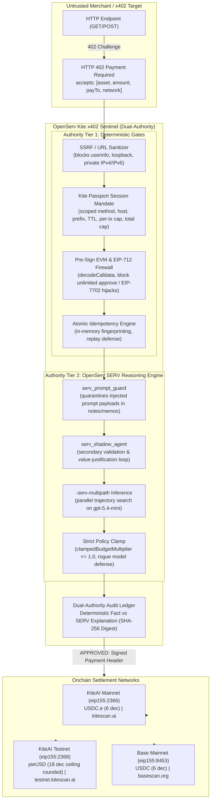

# OpenServ Kite x402 Sentinel

> **Dual-Authority Autonomous Payment Firewall & x402 v2 Settlement Gateway**  
> Powered by **OpenServ Agent SDK (`@openserv-labs/sdk`)**, **SERV Reasoning (`serv_prompt_guard` + `serv_shadow_agent` + `-serv-multipath`)**, and **Deterministic Kite Agent Passport Session Mandates** across **Kite Mainnet (`2366`)**, **Kite Testnet (`2368`)**, and **Base Mainnet (`8453`)**.

[](https://khanhtnq.github.io/openserv-kite-x402-sentinel/)
[](https://github.com/Khanhtnq/openserv-kite-x402-sentinel)
[](https://www.openserv.ai/hackathon-2)
[](https://github.com/Khanhtnq/openserv-kite-x402-sentinel)

---

## 1. System Architecture



An architectural SVG diagram is available in [`docs/architecture.svg`](docs/architecture.svg).

---

## 2. Core Invariants & Security Guarantees

1. **Dual-Authority Separation**:
   - **Deterministic TypeScript Policy** is the sole binding authority on spending limits, endpoint scoping, and transaction execution.
   - **OpenServ SERV Reasoning** provides intelligent contextual evaluation, prompt-injection defense, and value analysis.
   - A rogue or hallucinating LLM proposing an inflated budget multiplier (`simulateRogueModelProposal: { proposedAmountMultiplier: 10 }`) is strictly clamped (`clampedBudgetMultiplier <= 1.0`) and blocked by deterministic policy gates.
2. **Deterministic Ceiling Rounding (`atomicToUsdMicros`)**:
   - For high-precision tokens (such as 18-decimal `pieUSD` on Kite Testnet), rounding uses `((amountAtomic * 1_000_000n + scale - 1n) / scale)`.
   - Sub-micro dust can never bypass session spending limits or accumulate unaccounted drain.
3. **Pre-Sign EVM & EIP-712 Calldata Firewall**:
   - Blocks unlimited ERC-20 token approvals (`>= 2^128 - 1`).
   - Blocks EIP-7702 batch delegation hijacks in transaction `authorizationList`.
   - Blocks `setApprovalForAll` NFT draining patterns.
   - Blocks EIP-712 permit and EIP-3009 messages if the spender/payee does not match the authorized merchant `payTo`.
4. **Active Prompt Injection Quarantine**:
   - Integrated with OpenServ `serv_prompt_guard` tool declaration and deterministic pre-check scanning.
   - Detects adversarial injection payloads in `merchantUntrustedNote` or challenge metadata, quarantining them with `BLOCKED_PROMPT_INJECTION` before LLM processing.
5. **SSRF & Endpoint Scoping**:
   - Validates all merchant URLs: enforces `https://`, strips credentials/userinfo (`@`), and blocks private IPv4/IPv6 ranges (`127.0.0.0/8`, `10.0.0.0/8`, `172.16.0.0/12`, `192.168.0.0/16`, `169.254.0.0/16`, link-local, loopback).
   - Enforces exact HTTP method, target hostname, and pathname prefix matching the Kite Agent Passport session delegation.

---

## 3. Deployment & Runtime Modes

Sentinel is designed for flexibility across different agent environments:

| Mode | Command / Path | Description |
|:---|:---|:---|
| **Interactive Live Demo** | [`https://khanhtnq.github.io/openserv-kite-x402-sentinel/`](https://khanhtnq.github.io/openserv-kite-x402-sentinel/) | Zero-install interactive browser playground executing client-side simulations of prompt-injection defense, rogue model clamping, and EVM calldata audits. |
| **OpenServ Agent SDK** | `npm run agent` | Runs as an autonomous agent on OpenServ network via `@openserv-labs/sdk` registering `audit_kite_x402_payment`, `simulate_evm_firewall`, and `compile_kite_delegation` capabilities. |
| **Node.js Gateway / Server** | `npm start` | Production HTTP server with interactive web workbench, `GET /.well-known/x402`, and `POST /v1/sentinel/audit`. |
| **Terminal CLI Demo** | `npm run demo` | Verifies all 5 core security scenarios in the terminal with zero network dependencies. |
| **Stateless Edge Worker** | `src/worker.ts` / `wrangler.toml` | Low-latency Cloudflare Worker deployable directly to the edge for distributed AI agent clusters. |

---

## 4. Quickstart & Installation

### Prerequisites
- Node.js `>= 20.0.0`
- npm `>= 10.0.0`

```bash
# Clone the repository
git clone https://github.com/Khanhtnq/openserv-kite-x402-sentinel.git
cd openserv-kite-x402-sentinel

# Install dependencies
npm install

# Run the complete test suite (53 unit + integration + adversarial + edge worker tests)
npm test

# Run TypeScript compilation check
npm run typecheck

# Run the live interactive terminal demo
npm run demo
```

---

## 5. Configuration & Environment Variables

Copy `.env.example` to `.env` and configure your keys:

```bash
cp .env.example .env
```

| Environment Variable | Description | Default |
|:---|:---|:---|
| `SENTINEL_PAY_TO` | Canonical EVM payment recipient address | `0xcbEDbeCC127a32217075Ff40f16Ec804aa1E0533` |
| `KITE_NETWORK` | Default Kite network (`mainnet` or `testnet`) | `mainnet` |
| `SELLER_PRICE_USD` | Baseline seller price for audit endpoints | `0.001` |
| `OPENSERV_API_KEY` | OpenServ API key for live SERV Reasoning calls | Optional (falls back to deterministic simulation) |
| `SERV_BASE_URL` | OpenServ Reasoning API endpoint | `https://inference-api.openserv.ai/v1` |
| `SERV_MODEL` | SERV Reasoning model identifier | `gpt-5.4-mini-serv-multipath` |
| `PORT` | Local HTTP server port | `7378` |

---

## 6. HTTP & OpenServ Agent Integration

### Running the HTTP Settlement Gateway
```bash
npm start
```

Available endpoints:
- `GET /health`: Health status and registered settlement networks.
- `GET /.well-known/x402`: Public x402 service discovery manifest.
- `POST /v1/sentinel/audit`: Payment audit and settlement authorization endpoint (returns HTTP 402 challenge when unpaid, HTTP 200 when authorized with demo flag or valid payment header).

### Running as an OpenServ Platform Agent
```bash
npm run agent
```
Registers the Sentinel agent with `@openserv-labs/sdk`, enabling other autonomous agents on the OpenServ network to request secure payment audits, session compilations, and pre-sign calldata verifications.
